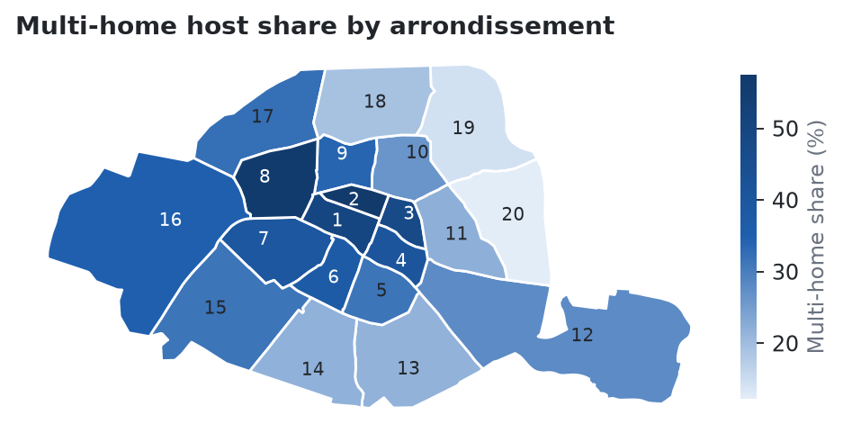

# Who runs short-term rentals in Paris?

An analysis of the Inside Airbnb snapshot for Paris (16 September 2026). I wanted to know how much of the active entire-home supply belongs to hosts with several homes, where they are, and whether the registration number field is good enough to flag problem listings.



## What I found

Scope: 32,473 entire homes with a minimum stay under 30 nights and a review in the last 12 months, out of 77,149 listings.

- **Hosts with 3 or more entire homes run 31.5% of these listings**, and they are only 1,214 of 22,829 hosts. The top 1% of hosts hold 19.4% of the listings.
- **It is a central Paris pattern.** The share is 57.5% in the 2nd, 56.7% in the 8th and 50.2% in the 1st, against 12.2% in the 20th.
- **Multi-home listings get booked more.** Median estimated nights are 135 against 83 per year. That holds inside all 20 arrondissements, with a median gap of 44 nights, so location alone does not explain it.
- **They are rated a little lower**, 4.66 against 4.82 on average.
- **The registration field is mostly filled in, and that says little.** 94.1% of listings have a number in Paris format. Still, 79 use obvious placeholders such as 7512345678900, 755 have none, and 215 numbers appear under more than one host account (495 listings). Shared numbers can have innocent causes, like co-hosting.
- Among listings from hosts with one entire home, 46.1% have more than 90 estimated nights and 32.9% more than 120.

## What this can't tell you

Nights are Inside Airbnb's estimate from reviews, capped at 255, so they are approximate. "3 or more homes" is my threshold, and the notebook shows the result for 2, 5 and 10 too. A review in the last 12 months is a rough sign of activity. The data can't say which homes are primary residences, and nothing here checks numbers against the city's register, so the night counts and number problems are places to look, not evidence of breaches. Sources disagree on whether the primary residence limit in Paris is 90 or 120 nights, so I show both.

Estimated revenue is missing for 25.3% of listings and I don't use it for any conclusion.

## Run it

```bash
pip install -r requirements.txt
./get_data.sh
jupyter notebook notebooks/analysis.ipynb
```

Data: [Inside Airbnb](https://insideairbnb.com/get-the-data/), CC BY 4.0. It is not stored in this repository. Results only appear in aggregate, with no host or listing named.

The original idea of a New York Airbnb EDA came from [this tutorial by Zero Analyst](https://www.youtube.com/watch?v=fG1ENgJh_fk). The city, the questions and the analysis here are mine.
